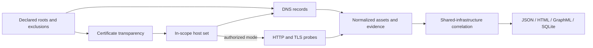

# DomainRecon

DomainRecon inventories domains and subdomains, fingerprints DNS/TLS/HTTP services, maps shared infrastructure between multiple root domains, and reports non-invasive security configuration findings.

It is deliberately narrower than [reconFTW](https://github.com/six2dez/reconftw): Python owns orchestration, normalized evidence, correlation, and reporting. It does not exploit vulnerabilities, spray credentials, download breach dumps, or silently run third-party scanners. This makes the default workflow reproducible and suitable for authorized asset-management and defensive security work.

## Capabilities

- Passive subdomain discovery from certificate-transparency data
- A, AAAA, CNAME, MX, NS, TXT, and CAA collection
- HTTPS/HTTP status, title, server, redirect, and security-header fingerprinting
- TLS certificate, issuer, SAN, cipher, and protocol inventory
- Cross-domain links based on shared IP, nameserver, and mail infrastructure
- JSON, standalone HTML, GraphML, and SQLite output
- Historical scan browser with baseline change detection
- Asset risk scoring and connected-domain clustering
- Optional Subfinder enrichment when the binary is available
- Optional screenshots for authorized active scans (`pip install -e '.[screenshots]'` then `playwright install chromium`)
- Strict root-domain/exclusion scope, host caps, timeouts, concurrency limits, and private-address protection
- Passive-only mode and an explicit authorization gate for direct probes

## Install

Python 3.11 or newer is required.

```bash
python3 -m venv .venv
. .venv/bin/activate
pip install -e '.[dev]'
```

## Use

Start the local HTML interface:

```bash
domainrecon serve
# Open http://127.0.0.1:8765
```

The web interface keeps active scans behind the same authorization confirmation as the CLI and binds to localhost by default.

CLI usage:

Passive discovery and DNS inspection:

```bash
domainrecon scan example.com example.org --passive
```

Authorized HTTP/TLS fingerprinting:

```bash
domainrecon scan example.com example.org --authorized --exclude dev.example.com
```

Results are written to `recon-output/`:

- `report.html` — readable assessment
- `report.json` — normalized automation format
- `graph.graphml` — import into Gephi, Cytoscape, or Neo4j tooling
- `domainrecon.sqlite3` — scan history

Run `domainrecon scan --help` for scope, host-limit, timeout, and concurrency controls.

## Workflow



## Security and ethics

Only scan assets you own or have explicit permission to assess. `--authorized` is an audit acknowledgement, not proof of permission. Passive mode still sends DNS queries and requests public CT data. Public-information support means metadata and exposure indicators; DomainRecon intentionally does not acquire or expose leaked credentials or breach-dump contents.

The HTTP client does not follow redirects and rejects hosts resolving to private, loopback, link-local, reserved, or other non-global addresses unless both `--allow-private` and `--authorized` are supplied. This limits SSRF-style pivoting and accidental internal scans.

## Extension points

Collectors operate on the shared `ScanResult` model. Add a collector under `src/domainrecon/`, retain source/evidence on every asset and finding, enforce `Scope.contains()` before network access, and place intrusive integrations behind a separate authorization/profile gate. Suitable future adapters include Subfinder (passive enumeration), httpx (large-scale probing), Nuclei with a curated non-destructive template allowlist, and RDAP providers.
